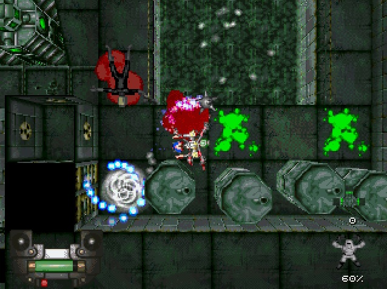
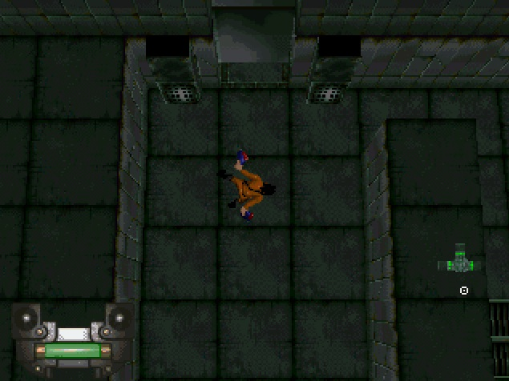
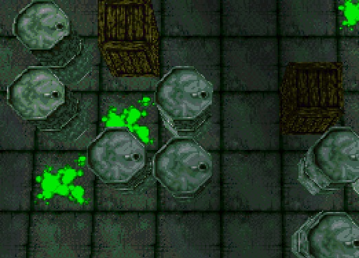
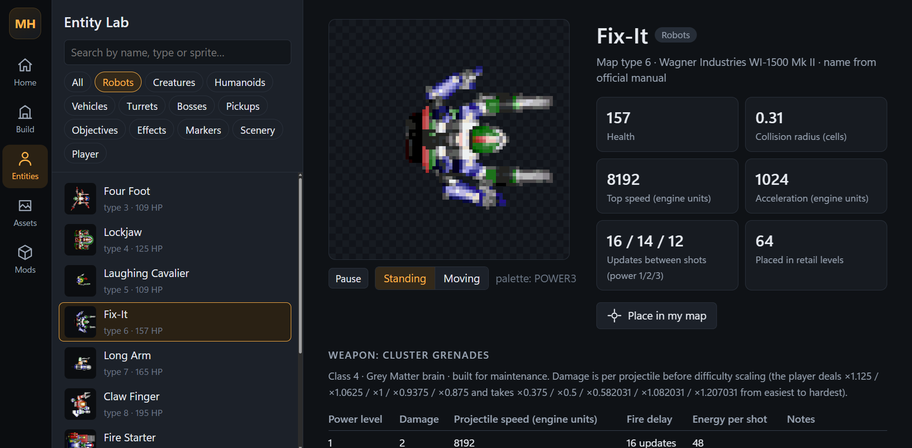
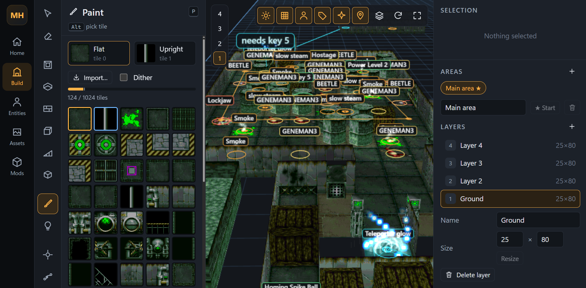
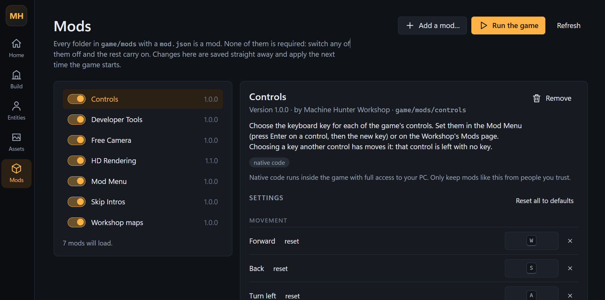
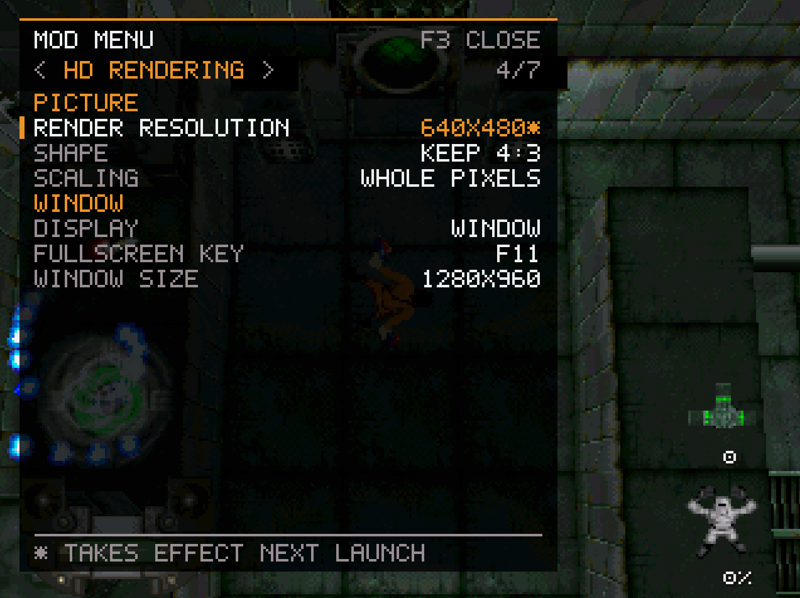
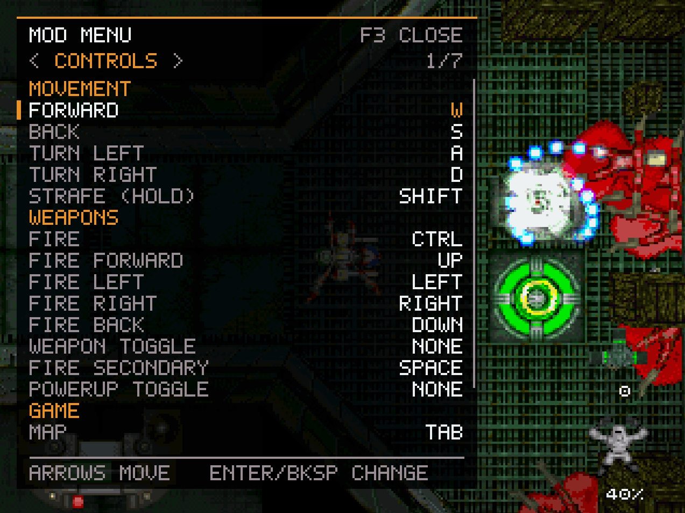
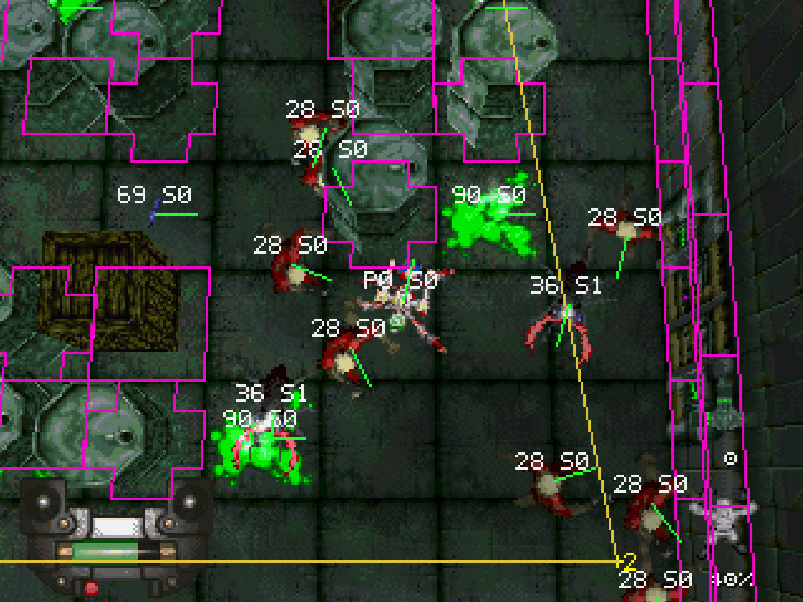

# Machine Hunter Workshop v0.1


A map editor and modding toolkit for the 1997 Windows version of **Machine Hunter**. Build maps, edit entities, browse game assets and launch your creations in the original game engine.

- Detailed map editor
- in-game diagnostic menu
- 2x 'HD' rendering capabilities (running at least at native asset resolutions, then upscaled)
- use custom textures and sounds in the Workshop
- tons of free bugs

There are bugs. Stupid ones.
Known bugs:
- setting a trigger manually doesn't seem to work properly. not fully tested
- assets rendered 2 layers above the player, created in the editor specifically, pop in and out sometimes
- retail map hard-coded missions persist through custom missions
Untested, likely to be buggy:
- entity creator
- effect creator is pretty bare bones
## Download

Download **MachineHunter-Workshop-v0.1-windows-x64.zip** from this repository's Releases page. Extract the entire ZIP into a writable folder, such as `C:/Games/MachineHunterWorkshop`. Do not run it inside the ZIP or extract it over your original game installation.

You need Windows 10/11 **64-bit**, a modern browser with WebGL, and your own copy of the original Windows game. The release includes its application runtime and built mods: **no Node.js, npm, Visual Studio or internet connection is needed to install or run it**. GitHub's automatic Source code downloads are for developers; use the Windows release ZIP to run Workshop.


## First-time setup

1. Double-click **Setup.bat**.
2. Select your original Machine Hunter folder. It must contain:

   ```text
   MACHHUNT.EXE
   DATA/
     DATA.ARC
   MOVIES/
     TITLE1.ETV
     TITLE2.ETV
   ```

3. Wait for **Setup complete**. Setup copies these required files into Workshop and creates a compatible game executable there. Your original installation is left unchanged.
4. Double-click **Workshop.bat**. Your browser opens the editor at `http://localhost:5174`.
5. Double-click **Play.bat** to start the game without opening the editor.

Workshop and Play offer setup automatically if files are missing. Rerun Setup.bat to repair the copied game files. Keep the Workshop console open while editing; closing it stops the local server.



### Supported game version

v0.1 requires the **unmodified 699,904-byte Windows retail MACHHUNT.EXE**. Setup validates its SHA-256:

```text
1e89f2a61c7627426301fd1c45424981ceba643036b4d536df91cb1f6b986714
```

Other regional, demo or previously patched executables are unsupported. If your installation lacks the movies, copy MOVIES from your own game disc into that installation first.

## Make and play a map

1. Choose **New map** and select a theme.
2. Draw a room and place a player start from Entities.
3. Add floors, walls, blocks, ramps and scenery. Adjust selected items in the inspector. Use interactive tools for doors, keys, triggers, teleporters and exits.
4. Save your map as a **.mhproject** file.
5. Press **Save & Play** / **Play** to build and launch it. Close an already running game before launching another copy.

Save projects wherever you choose. Autosaves are separate copies in `projects/autosave`. Keep your editable .mhproject files backed up; an installed play copy is not a substitute for your project.

**F3** opens the in-game Mod Menu; **F11** toggles windowed/fullscreen. Installed maps appear under **MAPS** in the main menu. Enable mods and adjust settings on Workshop's Mods page. The editor's Help screen explains its tools and shortcuts.

## Included tools

- Map builder: rooms, floors and walls, see-through textures, blocks and adjustable pillars, ramps, lighting, scenery and custom props.
- Touch/key/trigger doors, five keycards, breakables, teleporters, exits and hazards.
- Animated entities, paths, friendly characters and per-map custom enemies.
- Asset browser for your own game's textures, sprites, pictures and sounds.
- Mod Menu, HD Rendering, Controls, Free Camera, Skip Intros and Developer Tools.

To make mods, see [docs/MODDING.md](docs/MODDING.md).



## Troubleshooting

| Problem | What to do |
| --- | --- |
| Unsupported executable | Use the untouched retail EXE above. Renaming another EXE will not make it compatible. |
| Missing files | Rerun Setup.bat and select the folder containing MACHHUNT.EXE, DATA and MOVIES. |
| Browser cannot connect / Failed to fetch | Keep the console open. Restart Workshop.bat and open the address printed there. |
| Port 5174 is in use | Close the other Workshop console, then launch again. |
| Game already running | Close it before pressing Play again. |
| Keycard door stays shut | Check its required key and place the matching pickup. The inspector warns when the key is missing. |
| Terrain disappears in a very dense scene | The original renderer has a 2,047-face frame budget. Workshop removes hidden block faces, but especially dense geometry can still reach the limit. Reduce nearby geometry if necessary. |
| Other errors | Read `game/logs/mh-runtime.log`, also shown on the Mods page. Report the error and reproduction steps; do not upload retail files. |

## Updating or removing

Extract future releases into a new folder, keep your .mhproject files and custom mods backed up, and run Setup for the new release. To uninstall, close Workshop and the game, back up your work, and delete the extracted folder. The original game installation is unaffected.



## Source and license

Workshop's original code is **GPL-3.0-only**; see [LICENSE](LICENSE) and [THIRD-PARTY-NOTICES.md](THIRD-PARTY-NOTICES.md). Its corresponding source ZIP is included under `source/` in the Windows download and supplied separately with the release. Developer instructions are in `docs/DEVELOPING.md` in the source distribution.

This is an unofficial fan tool. Machine Hunter and its original assets belong to their respective rights holders. No game executable, archive, movies, maps or other proprietary assets are distributed with Workshop.
